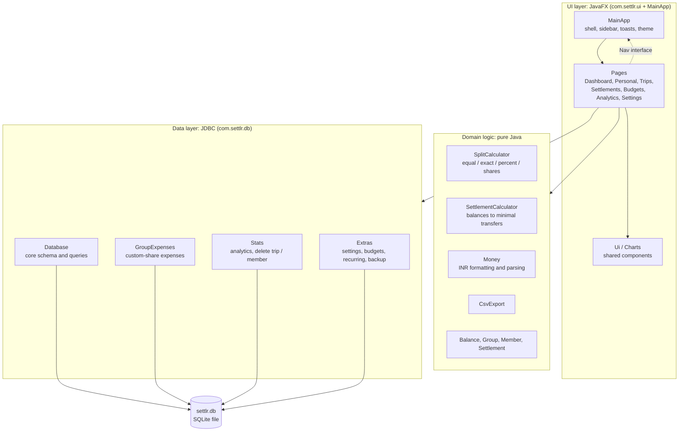
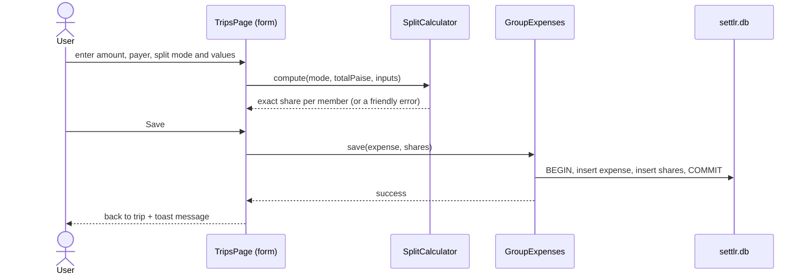
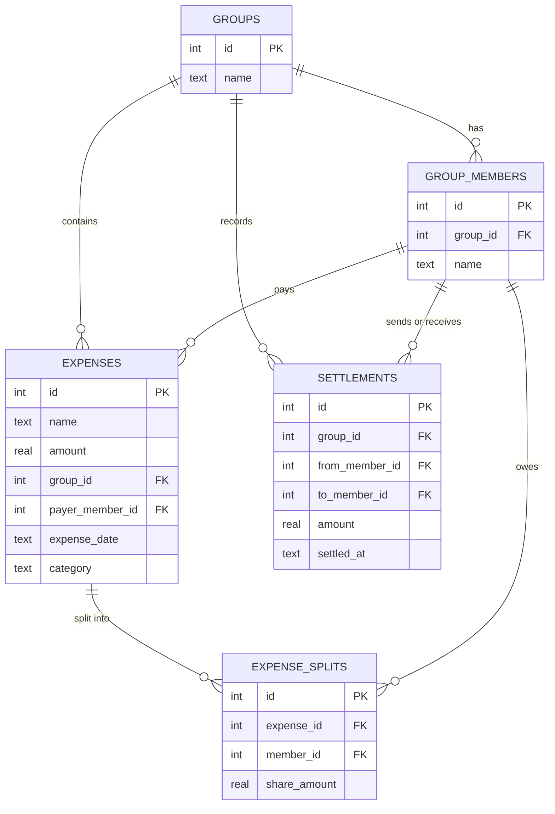

<div align="center">

# Settlr Desktop

**Expense management and bill splitting for individuals, roommates and travel groups.**

Track personal spending, split shared costs any way you like, see exactly who owes whom, and settle up, all in one polished desktop app that stores everything locally.


</div>

---

## Table of contents
1. [Overview](#overview)
2. [Screenshots](#screenshots)
3. [Features](#features)
4. [System architecture](#system-architecture)
5. [Database design](#database-design)
6. [How the money logic works](#how-the-money-logic-works)
7. [Tech stack](#tech-stack)
8. [Project structure](#project-structure)
9. [Getting started](#getting-started)
10. [Testing](#testing)
11. [Building an installer](#building-an-installer)
12. [Data, backup and CSV exports](#data-backup-and-csv-exports)
13. [Roadmap: Settlr Web](#roadmap-settlr-web)
14. [Author](#author)

---

## Overview

When friends share a trip, a flat or a night out, working out who paid what and who owes whom quickly turns into spreadsheets, chat threads and mistakes. **Settlr** replaces that with one organised place:

- record what you spend, personally or with a group
- split each cost equally, by exact amounts, by percentage or by shares
- see every member's net balance and the smallest set of payments that settles everyone
- keep a history of expenses and repayments, with budgets and analytics on top

Settlr Desktop is a standalone application. There is no account, no server and no internet requirement: your data lives in a single local file.

---

## 📸 Screenshots

### Dashboard
Spending overview, budget watch, recent expenses, and monthly spending chart.


### Personal Expenses
Add expenses, search, filter by month, category or date range, edit or delete expenses, and export to CSV.


### Trip Details — Goa Trip
Manage members, shared expenses, trip summaries, payer information, and category-wise spending.


### Settlements
View member balances, outstanding transfers, suggested payments, and completed settlements.


### Budgets — Dark Mode
Set monthly limits, monitor budget progress, and manage recurring expenses.


### Analytics — Dark Mode
Explore category-wise spending, pie charts, monthly trends, and financial summaries.


### Settings — Dark Mode
Manage your profile, appearance preferences, local database backup, and application information.


---

## Features

### Personal expenses
- Add, edit and delete expenses with a name, amount, category and date
- **Undo** after deleting
- Search by name; filter by month, category and date range
- Running total for whatever is currently filtered
- **Export to CSV** (opens cleanly in Excel and Google Sheets)

### Trips and groups
- Create trips, add members and remove members who have no activity
- Record shared expenses with a **date**, a **category** and a **payer**
- Spending breakdown by category for every trip
- Delete a trip together with its expenses, shares and settlements

### Flexible splitting
| Mode | What you enter | Example |
|---|---|---|
| **Equally** | nothing | ₹1,000 among 3 = ₹334, ₹333, ₹333 |
| **Exact amounts** | a rupee amount per person | ₹500 + ₹300 + ₹200 |
| **Percentages** | a % per person (must total 100) | 50% / 30% / 20% |
| **Shares** | a number of shares per person | 2 shares vs 1 share |

A live preview shows each person's amount as you type. Shares always add up to the total, to the paisa.

### Balances and settlements
- Net balance for every member (who should receive, who owes)
- A minimal list of "who pays whom" transfers
- Mark a transfer as paid and keep a settlement history
- Export a full trip report (expenses, balances and transfers) as CSV

### Budgets and recurring expenses
- Monthly limit per category with a green / amber / red progress bar
- A warning toast when you reach 80% or exceed a budget
- Recurring expenses (rent, subscriptions) added automatically each month

### Analytics
- Spending by category with a colour-matched pie chart and breakdown bars
- Period filter: all time, this month, last 3 months, this year
- 6-month trend on the dashboard and a 12-month trend in Analytics

### Experience
- Premium fintech design: navy sidebar, restrained blue accents, white cards, Poppins typography
- **Light and dark themes**
- Toast notifications, inline validation and an add / edit expense form that stays in the same window
- One-click **backup** of your database

---

## System architecture

Settlr is a layered desktop application. The UI never talks to the database directly, and the money logic is pure Java with no UI or database dependencies, so it is fully unit tested.



**Design decisions**
- **Pages are independent classes.** Each page renders into the main content area and asks the shell to navigate through the small `Nav` interface, so pages never depend on each other.
- **Money is handled in whole paise.** Splits and settlements are computed with integer arithmetic (largest-remainder allocation), so nothing is ever lost to floating-point rounding.
- **Atomic writes.** Saving an expense and its shares happens in one database transaction; if anything fails, nothing is saved.
- **Self-migrating database.** On start, Settlr adds any missing tables or columns, so older `settlr.db` files keep working.
- **Theming through variables.** Every colour is a CSS variable on `.root`; the dark theme is a small override file.

### Request flow: recording a shared expense



---

## Database design

A single local SQLite file, `settlr.db`.



Standalone tables:

| Table | Purpose |
|---|---|
| `personal_expenses` | Personal spending: name, amount, category, date |
| `budgets` | Monthly limit per category |
| `recurring` | Recurring expenses: name, amount, category, day of month, last posted month |
| `settings` | Key/value preferences (theme, your name) |

---

## How the money logic works

**Net balance** for each member of a trip:

```
balance = paid − share + settlements sent − settlements received
```

A positive balance means the member should receive money; a negative balance means they owe money.

**Worked example.** Four friends spend ₹4,000 on a trip: A pays ₹2,000 for accommodation, B pays ₹1,200 for food, C pays ₹800 for transport and D pays nothing. Split equally, each share is ₹1,000.

| Member | Paid | Share | Net balance |
|---|---:|---:|---:|
| A | ₹2,000 | ₹1,000 | **+₹1,000** |
| B | ₹1,200 | ₹1,000 | **+₹200** |
| C | ₹800 | ₹1,000 | **−₹200** |
| D | ₹0 | ₹1,000 | **−₹1,000** |

Settlr then suggests the fewest payments that clear everyone (for example D pays A ₹1,000, C pays B ₹200). With *n* people it never needs more than *n − 1* transfers.

---

## Tech stack

| Area | Technology |
|---|---|
| Language | Java 21 |
| UI | JavaFX 21 with custom CSS (light and dark themes) |
| Build | Maven |
| Database | SQLite via `sqlite-jdbc` |
| Typography | Poppins (bundled, SIL Open Font License) |
| Testing | JUnit 5 |
| Packaging | `jpackage` |

---

## Project structure

```
Settlr-Desktop/
├── pom.xml
├── README.md
├── docs/                          screenshots and sample exports
├── scripts/
│   └── package.sh                 builds a native installer
└── src/
    ├── main/
    │   ├── java/com/settlr/
    │   │   ├── MainApp.java               app shell: sidebar, navigation, toasts, theme
    │   │   ├── Launcher.java              entry point for the packaged app
    │   │   ├── Money.java                 INR formatting (lakh grouping) and parsing
    │   │   ├── SplitCalculator.java       equal / exact / percent / shares to exact paise
    │   │   ├── SettlementCalculator.java  balances to minimal transfers
    │   │   ├── CsvExport.java             CSV reports
    │   │   ├── Balance.java, Group.java, Member.java, Settlement.java
    │   │   ├── db/
    │   │   │   ├── Database.java          core schema and queries
    │   │   │   ├── GroupExpenses.java     expenses with custom shares, date, category
    │   │   │   ├── Stats.java             analytics queries, delete trip / member
    │   │   │   └── Extras.java            settings, budgets, recurring, backup, migrations
    │   │   └── ui/
    │   │       ├── Nav.java               what pages can ask the shell to do
    │   │       ├── Ui.java, Charts.java   shared components and charts
    │   │       └── DashboardPage, PersonalPage, TripsPage, SettlementsPage,
    │   │           BudgetsPage, AnalyticsPage, SettingsPage
    │   └── resources/com/settlr/
    │       ├── ui/settlr.css, settlr-dark.css
    │       └── fonts/Poppins-*.ttf
    └── test/java/com/settlr/
        ├── SplitCalculatorTest.java
        └── SettlementAndMoneyTest.java
```

---

## Getting started

### Prerequisites
- **JDK 21** or newer
- **Maven 3.9+**

### Run
```bash
git clone https://github.com/Saiyam-Kumar/Settlr-Desktop.git
cd Settlr-Desktop
mvn javafx:run
```

The first launch creates `settlr.db` in the folder you start the app from. Existing databases are upgraded automatically.

---

## Testing

```bash
mvn test
```

The unit tests cover the parts where mistakes would cost real money:

- every split mode, including rounding, invalid percentages and mismatched exact amounts
- settlement suggestions, checked so that everyone's balance ends at zero
- Indian-style currency formatting and amount parsing

---

## Building an installer

Requires a full JDK 21+ (`jpackage` is included).

```bash
./scripts/package.sh
```

This produces a native installer in `target/installer` (`.dmg` on macOS, `.exe` or `.msi` on Windows, `.deb` on Linux).

---

## Data, backup and CSV exports

- All data is stored locally in `settlr.db`. Nothing leaves your computer.
- **Settings → Back up my data** saves a consistent copy of the whole database. To restore, close Settlr and replace `settlr.db` with the backup.
- **CSV exports** open directly in Excel or Google Sheets:
  - Personal expenses: [`settlr-expenses-2026-10-30.csv`](docs/settlr-expenses-2026-10-30.csv)
  - Trip report with expenses, balances and who pays whom: [`Goa-Trip-report.csv`](docs/Goa-Trip-report.csv)

---

## Roadmap: Settlr Web

Settlr Desktop is the first half of the Settlr platform. The planned **Settlr Web** version reuses the same data model and money rules and adds:

- user accounts and secure login
- shared groups that friends can join from different devices
- a server database (PostgreSQL or MySQL) instead of a local file
- a responsive React interface for computers and phones
- real-time sync of expenses and balances

Other ideas for Desktop: PDF reports, more currencies, and an app data folder instead of the launch directory.

---

## Author

**Saiyam Kumar**
GitHub: [@Saiyam-Kumar](https://github.com/Saiyam-Kumar)
Repository: [Saiyam-Kumar/Settlr-Desktop](https://github.com/Saiyam-Kumar/Settlr-Desktop)
